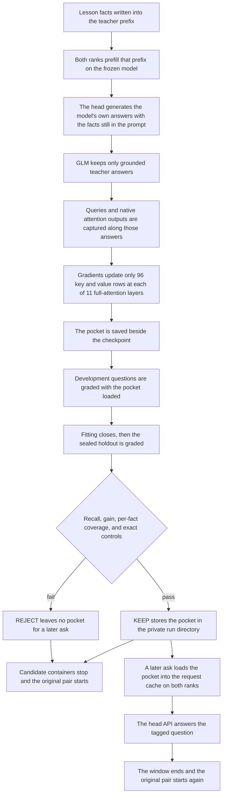

# GLM RSI Dream

GLM RSI Dream fits a small attention-memory pocket for GLM-5.3-Flash EXL3 and
serves it on two NVIDIA DGX Spark GB10 nodes, with the model split across the
pair (tensor parallelism of two). A pocket is learned memory loaded alongside
the model, like prefix tuning. The base weights stay frozen. The checkpoint
you started with is the checkpoint you still have when the window closes.

The working loop is ordinary and specific. The lesson facts are written into
a prompt. The frozen model answers from that prompt. The trainer then fits 96
key and value rows at each of 11 full-attention layers so those rows reproduce
the attention readout of the longer prompt. A later tagged question can load
the pocket, answer from the head node, and put the original containers back.

The project name looks ahead to a dream consolidation step. That step is
planned and is not built. Nothing in this checkout folds a pocket into the
base weights. What you can run is capture, a real gradient fit, a keep or
reject decision, tagged recall, and rollback of the original pair.

## Status

**v0.0.2** (Python package version `0.0.2`), an experimental release. A clean
installed source bundle completed the raw-fact loop on the Spark pair, from
model-authored questions through native fitting, generated answers, KEEP, and
ordinary-chat retention. The documented rollback restored the exact originals.
The source-result tables below are unchanged aggregates from that bundle. This
revision does not add a measured score.

That later research bundle uses the `glm-attnmem` updater and an ordinary-chat
routing hook. This checkout provides the `glm-rsi-dream` supplied-dataset loop
and tagged `ask` path. The results below identify the tested implementation;
native qualification of this checkout's exact CLI remains a verification target.

RSI Dreambox adds a password-protected portal, a local admin API, knowledge
intake and review, configurable extraction and grading, and an optional traffic
tap that is disabled by default. The [head-host guide](examples/predream/dreambox-head.md)
and [portal guide](examples/predream/admin-portal.md) describe local setup.

**Shared-expert dream learning: Under development.** The dream-to-neurons path
has not been delivered. `glm-dream-trigger` exercises artifact preparation and
paired lifecycle contracts on fictional CPU fixtures. Export and inference-loader
checks exercise supplied numerical additions. Those checks do not establish
native factual learning or an end-to-end consolidation capability. Dream and
schedule controls remain closed by default until the owner verifies pocket-OFF
recall and opens the host gate. See [the lifecycle contract](docs/DREAM_LIFECYCLE.md).

The [RSI Dreambox manual](docs/admin/README.md) covers Rules, Queue, Dreams and
schedule, Pockets, Autonomy and System in Simple and Advanced. The
[operator runbook](docs/DREAM_OPERATOR_RUNBOOK.md) covers manual consolidation,
activation, retirement and exact recovery. Portal help and manual pages share
the packaged `resources/admin_portal/help.json` content.

## Quick start

Two ways in. A laptop can plan the loop and run the CPU checks. Fitting,
recall, and rollback need the Spark pair, and they run only when you pass
`--live`.

### On a laptop

Supported Python versions are 3.11, 3.12, and 3.13. Dev dependencies are locked
in `uv.lock`. Install them with uv 0.13 or newer:

```sh
uv sync --locked --extra dev
uv run ruff check .
uv run mypy
CUDA_VISIBLE_DEVICES='' uv run python -m pytest -q
uv run glm-rsi-dream --config config.example.json --dry-run run
uv run python tools/prepare_baseline.py --config config.example.json
```

The dry run prints a plan. It lists capture, a fit of 96 rows at 11
full-attention layers, grading, a keep or reject decision, and restoration of
the original pair. `prepare_baseline.py` without `--live` prints the
provisioning plan and does not pull images or create containers.

These two planning commands open no subprocess or network connection and create
no run directory. The CPU tests exercise local contracts and attention gradients.
They do not load GLM weights or test native Spark serving. A green CPU run
confirms those local contracts. Learning acceptance still depends on generated
answers and exact controls on the pair.

### On the Spark pair

Live work requires exactly two NVIDIA DGX Spark GB10 nodes, Linux ARM64,
working SSH between the coordinator and both ranks, Docker access through the
standard Unix socket, and the external compatible TensorFold runtime and model
files described in [UPSTREAM.md](UPSTREAM.md). The native containers supply CUDA,
PyTorch, and their serving dependencies. Install the locked `dev` extra on the
head if using the CPU checks there. Read [MODEL-TERMS.md](MODEL-TERMS.md) before any downloads.

Copy the checkout to the head Spark. Put your own SSH identity, containers,
head API address and port, fabric address and interface, and protected service
probes in a local config file:

```sh
cp config.example.json config.json
# Edit config.json for this pair before using --live.
```

Every operator host, storage directory, and listener port lives in
`config.json`. The `.example` addresses and angle-bracket fields are
placeholders. Both `work_dir` entries and the CLI `--run` default use
`~/.cache/glm-rsi-dream`. The example used to say `/var/tmp/glm-rsi-dream`,
and `--run` used to default to `runs/demo-1`. Those defaults are now the
cache directory below. Keep configuration and run data out of source control.
Point dashboard and protected-service URLs at services you own on the pair.
The worker stays rank 1 and exposes no generation API.

For a pair that is already serving a compatible runtime, run on the head Spark:

```sh
glm-rsi-dream --config config.json --run ~/.cache/glm-rsi-dream/demo-1 \
  --lesson examples/synthetic/lesson.json --eval examples/synthetic/eval.json \
  --live run
```

The supplied lesson is fictional. Its teaching and evaluation questions are
fixed files, separate from the model-generated plan4 smoke, and they have no
published accuracy score. The packaged loop reads the lesson and evaluation
you pass. It does not write those files for you.

The loop trains each rank one after the other, grades development answers,
closes fitting before the held-out pass, checks controls, and restores the
original containers. A completed rejection returns exit code 2. An operation
failure returns 1. Afterward, read `check.json` and `restore-parity.json` in
the run directory. `check.json` holds the keep or reject verdict. A missing
`restore-parity.json` means the original pair was not accepted back.

For a fresh pair, first inspect the offline provisioning plan, then use
`python tools/prepare_baseline.py --config config.json --live` after reviewing
its external download terms and launch settings. Fresh provisioning and the
pinned image and checkpoint compatibility still need native qualification.
Existing container names stop provisioning before anything is created.

### Read a kept pocket

A pocket that was kept, and whose window restored the originals, can be read
in another temporary serving window:

```sh
glm-rsi-dream --config config.json --run ~/.cache/glm-rsi-dream/demo-1 \
  --question 'What is the Linden project helper called?' --live ask
```

`ask` uses this package's tagged evaluation path. The question still has to
match the lesson's route terms, or the pocket stays unloaded. An ordinary
untagged request does not install the pocket. The later source bundle's
ordinary-chat routing passed the bounded qualification in
[results/RESULTS.md](results/RESULTS.md). That routing hook is a different
path from this checkout's `ask` command.

When the ask window ends, the original containers are started again. The
pocket files remain in the private run directory. They are not written into
the model.

### Put the originals back by hand

STOP requests and restoration stay explicit:

```sh
glm-rsi-dream --config config.json --run ~/.cache/glm-rsi-dream/demo-1 \
  --live restore
```

A `STOP` file in the run directory requests restoration during an active loop.

## Where things live

The default data directory is `~/.cache/glm-rsi-dream`. The CLI `--run` default
changed from `runs/demo-1` to `~/.cache/glm-rsi-dream/demo-1`. The example
`work_dir` changed from `/var/tmp/glm-rsi-dream` to `~/.cache/glm-rsi-dream`.
A path that starts with `~/` is expanded on the machine that uses it: the
coordinator expands `--run` before it writes local files, and each Spark
expands `work_dir` for its own SSH account. An absolute path is used as written.

| What | Path |
| --- | --- |
| Default data directory | `~/.cache/glm-rsi-dream`, the `work_dir` of both hosts in `config.example.json` |
| Default coordinator run | `~/.cache/glm-rsi-dream/demo-1`, the CLI `--run` default. The basename `demo-1` is the run id |
| Remote run root | `<work_dir>/<run id>`, from `Transport.root`. With the defaults that is `~/.cache/glm-rsi-dream/<run id>` on each Spark |
| Baseline weights | `<work_dir>/baseline`, created by `tools/prepare_baseline.py` and mounted at `/models` (`/models/main`, `/models/drafter`) |
| CLI config | `config.example.json`, the `glm-rsi-dream --config` default |
| Operator config | `config.json`, the `prepare_baseline.py --config` default. Gitignored |
| Lesson and eval | `examples/synthetic/lesson.json` and `examples/synthetic/eval.json`, the CLI defaults |
| Packaged manifest | `src/glm_rsi_dream/resources/manifest.json`, read at startup and not rewritten by a run |
| Published results | `results/RESULTS.md` and `results/source-results.json`. The loop does not write these |

The coordinator writes these under `--run`: `state.json`, `events.json`,
`lesson.json`, `eval.json`, `freeze.json`, `tokenizer.json`, `teachers.json`,
`train-index.json`, `capture-complete.json`, `fit-report-rank0.json`,
`fit-report-rank1.json`, `selected.json`, `dev.json`, `heldout.json`,
`controls.json`, `check.json`, `evaluation-started.json`,
`untagged-baseline.json`, `restore-parity.json`, `protected-preflight.json`,
`protected-restored.json`, `pair/prefix.json`, `pair/pair.json`,
`pair/compiled-rank0.pt`, `pair/compiled-rank1.pt`, and `responses/`. An
operator can create `STOP` there. The loop reads it and does not create it.

Each Spark's remote run root receives `src/`, `pair/` (including
`pair/train-index.json`, `pair/compiled-rankN.pt`, and
`pair/requests/<request id>.json`), `bootstrap.pth`, `capture/`, `receipts/`,
`guard.json`, `guard.pid`, `guard.log`, `guard-done`, and, if a guard fires,
`guard-fired.json`.

Inside a candidate container those directories are mounted as `/opt/pocket`
(the remote root, read only), `/capture` (read write), and `/z-receipts`
(the remote `receipts/` directory, read write). `bootstrap.pth` is mounted at
`<site-packages>/glm-rsi-dream.pth`. The trainer reads `/opt/pocket/pair` and
`/capture`, and writes `/capture/fullstate-rankN.pt`,
`/capture/<request id>-rankN.pt`, `/capture/compiled-rankN.pt`,
`/capture/compiled-report-rankN.json`, `/capture/trainer-rankN.log`, and
`/capture/trainer-status-rankN.json`. Receipts are
`/z-receipts/<request id>-rankN.json`.

The candidate environment sets `TF_DREAM_CAPTURE=1`,
`TF_DREAM_CAPTURE_DIR=/capture`, `TF_DREAM_CAPTURE_MAX_BYTES=67108864`,
`TF_DREAM_CAPTURE_COPY_ROWS=32`, `TF_DREAM_CAPTURE_ENGINE_SHA256` from the
manifest, `TF_DREAM_EVAL=1`, and
`TF_DREAM_EVAL_MANIFEST=/opt/pocket/pair/pair.json`. It forces
`TF_GLM_HC_SPLIT=0` and `TF_GLM_PREFILL_OVERLAP=0`. If the original container
already has `TF_DREAM_*`, `LW_ADAPTER`, or `LW_CAPTURE_DIR`, cloning stops.
Fresh provisioning also passes the `baseline.environment` keys from config:
`HF_HUB_OFFLINE`, `TENSORFOLD_NO_UPDATE_CHECK`, `TENSORFOLD_MEMORY_RESERVE_GIB`,
`TF_GLM_COMM`, `NCCL_SOCKET_IFNAME`, `NCCL_IB_HCA`, `NCCL_IB_GID_INDEX`,
`NCCL_MIN_NCHANNELS`, `NCCL_MAX_NCHANNELS`, `TF_GLM_KV`, `TF_GLM_DENSE`,
`TF_GLM_MTP`, and `TF_GLM_HC_SPLIT`.

The agent reads `/var/run/docker.sock`, `/proc/meminfo`, `/proc/vmstat`, and
`/proc/net/tcp` and `/proc/net/tcp6`. The coordinator reads `/etc/dgx-release`
before live work. CPU CI sets `CUDA_VISIBLE_DEVICES`, `PYTHONDONTWRITEBYTECODE`,
and `UV_LOCKED`. This package does not read those three.

## How a pocket is trained, loaded, recalled, and rolled back

A pocket stands in for a long fact prefix. Training compares the model's own
attention, on answers the model just wrote while the facts were still in the
prompt, with the same attention using only 96 learned rows. The base weights
are not parameters of that fit.



The dream consolidation step is absent from this diagram on purpose. It is
planned, and this repository does not implement it.

### Train

On the head, the coordinator freezes the lesson and the evaluation file into
a new private run directory. Training, development, and held-out questions
must not share ids or wording. Every split must cover every fact. Protected
prompts and near misses must fall outside the lesson's route terms.

The teacher prefix is the system prompt plus the lesson statements under
`Reference facts:`. Newline tokens pad it until it covers the 96 memory slots
and its length is a multiple of 128. Both ranks prefill that prefix on the
frozen model and snapshot the full key/value cache and the recurrent state.
The backbone tensors are left untouched.

For each training question, the head generates an answer with that full prefix
installed, so the facts are still in the prompt. GLM grades the answer. If
the answer is outside the fact scope, capture stops. The accepted answer is
then appended, and a second forward records the queries, the cache, and the
native attention output along the answer span.

Each rank then fits, one rank after the other. Torch is seeded from the
manifest value 3153. At layers 3, 7, 11, 15, 19, 23, 27, 31, 35, 39, and 43,
the trainer takes 96 rows spaced along the teacher prefix cache and treats
only those rows as parameters. The target is the attention readout of the
full teacher cache on the frozen queries from the model's own answer, with
the causal suffix history held fixed. The loss is mean squared error of that
readout. The objective recorded with the fit is native attention-output
matching on frozen teacher queries.

Before the fitting loop, the relative residual norm against the native
attention output has to stay at or below 0.01, and a directional
finite-difference check has to agree with the analytic gradient within a
relative error of 0.08. The fitting loop runs Adam for 300 steps at learning
rate 0.01. The rows are stored in the runtime's FP8 cache format. The
recurrent KDA state from the full teacher prefix is kept as an anchor and
restored with the pocket. A lower fitting loss, by itself, does not accept
a memory.

### Load

The pocket is a pair of rank-owned tensor files in the private run directory,
plus the frozen prefix the KDA anchor came from. Loading happens inside a
temporary serving window. The original containers are cloned, the originals
are stopped, and the candidates serve. Candidate restart is turned off, so a
failed candidate cannot come back after a planned restore.

On a tagged request that asks for memory, both ranks reserve the prompt
extent and agree on the geometry before any model forward. They then install
the 96 learned rows into that request's cache and restore the teacher-prefix
KDA anchor. Those rows take the place of the long fact prefix, and the
question tokens follow them. The ordinary system prefix has to match the
frozen template before that swap, or the install is refused. If the ranks
do not agree, that request's slot is released and the head refuses the
request. A failed rank exchange marks the decoder broken. Health then
reports the pair desynchronized, and the head returns HTTP 503 until
recovery. The base weights stay as they were throughout.

An untagged request does not install the pocket. A tagged request whose
wording misses the lesson routes does not install it either. In this
checkout, route terms are explicit word groups on the lesson, and the request
carries evaluation metadata. The worker remains rank 1 and has no generation
listener. Only the head API generates.

### Recall

Recall is the `ask` command, or the held-out and development passes inside
`run`. The pocket is used only when the request is tagged, the route admits
the question, and a selected pocket is named. The head then generates with
temperature 0.

Inside `run`, development questions are graded first. If grounded development
recall is below the configured bar, the held-out questions stay unopened and
the verdict is reject. When development passes, fitting is closed and the
sealed held-out questions are scored three ways: the pocket, the same
questions with no memory, and the full fact prefix still in the prompt.
Protected prompts and near misses must match the no-memory replies, and their
receipts must show that memory was not installed.

The example config asks for held-out grounded recall of at least 0.8, a gain
of at least 0.2 over the no-memory baseline, development recall of at least
0.8, and at least one grounded held-out answer for every fact. Deterministic
alias checks and GLM's own semantic judgment both have to agree before an
answer counts as grounded. A passing CPU suite cannot substitute for that.

`ask` opens a window only for a run whose verdict was keep, whose restore
already succeeded, and whose frozen lesson contract, package manifest, and
tensor hashes still match. It answers one question and restores the originals
again.

### Roll back

Rollback puts the original containers back. The checkpoint was never updated,
and the lesson remains in the pocket files. The controller stops every owned
candidate and trainer, starts the original worker and then the original head,
and checks that each original is running with the same
container id, Config, HostConfig, and image recorded at the start. Protected
probes run again. The preservation check compares reply text bytes, finish
reason, and completion-token count for the configured protected prompts.

Host-local guards watch memory, sustained swap-out, dashboard and protected
services, and the recovery deadline. They restore the originals on a failed
probe or when that deadline arrives. If the coordinator itself is lost, a
window can stay up until a guard sees a failure or reaches the deadline. A
`STOP` file is the explicit request to restore during a live loop.

The later installed source bundle demonstrated retained memory and exact
rollback on its configured pair, including both original container identities
and 8/8 complete protected replies. Real interruption, paired corruption,
fresh provisioning, and this checkout's own recovery path remain native
verification targets.

## What the source experiments found

The source experiments are small, and they are the evidence this release has.
On Round 3, a 96-row pocket answered 34 of 36 held-out questions in a grounded
way. The same questions scored 35 of 36 with the full fact prefix still in
the prompt, and 1 of 36 with neither. That comparison is what this method
measures: a short learned cache standing in for a longer document prefix.
The set is consumed, so it stays a result about that set.

Model self-grading is identified below wherever it was used. The full record
is [results/RESULTS.md](results/RESULTS.md).

| Experiment | Learned held-out | Baseline | Full in-context carrier | Development | Controls |
| --- | --- | --- | --- | --- | --- |
| Round 3, 96 rows on 11 full-attention layers | 34/36 grounded | 1/36 | 35/36 | 12/12 | 30/30 byte-exact |
| Self-run RSI smoke, plan4 | 18/18 | 0/18 | Not reported | 6/6 | 30/30 tagged controls exact |
| Installed raw-fact updater, fictional fixture | 18/18 grounded | 0/18 | 18/18 grounded | 6/6 | 30/30 isolation controls exact |
| Precision continuation, 224 learned rows | 24/24 grounded | 2/24 | 24/24 grounded | 12/12 | 30/30 tagged controls exact |

For plan4, the model generated fictional facts, wrote the questions, graded its
own answers, and decided **KEEP**. The installed updater also decided **KEEP**
on its fresh fictional fixture. These are distinct runs. Grounded scores for
the updater and precision continuation are GLM self-grades. Their held-out
questions were sealed before fitting and are now consumed. The precision run
changed both teacher style and compression density, so it does not isolate
their individual effects.

After the continuity experiment, the later source bundle's three accepted
pockets remained in ordinary serving. Final re-acceptance passed 60/60 exact
ordinary preservation controls, 42/42 supported development/admission questions,
6/6 user-only probes, and 8/8 complete protected replies. An earlier keeper
qualification blocked all 90 admission-negative checks. The documented rollback
was previously executed and restored both exact original container identities
and 8/8 protected replies. The final continuity round verified the preserved
originals while keeping the accepted service running; rollback remained available
for failure or instability.

An extra user-only name-verb question bypassed memory after the initial serving
gate. Admission was tightened with independently sampled, blind-scope-reviewed
coverage probes. The failing phrasing then passed a direct regression check on
the retained pair, with both rank activations verified. That failure and repair
bound the routing claim; these finite checks establish no general routing guarantee.

An **early concept-only continuity experiment** recorded unprompted first-turn
tool calls on 17/18 tasks both before and after teaching. Self-graded correct,
grounded first actions rose from 14/18 to 16/18; the complete concept carrier
scored 17/18. GLM chose KEEP under the original quality rule. The primary
call-frequency hypothesis received no gain. Calls were recorded, not executed,
and this is first-action evidence rather than complete workflow evidence.

The continuity controls measured two distinct properties: 30/30 off-path
controls preserved exact answer content, completion tokens, finish reason, and
normalized tool calls; 30/30 knowledge-attached controls passed model quality
grades and emitted zero inappropriate continuity calls. The continuity pocket
remains a retained experimental artifact used in tagged evaluation. It is inactive
in ordinary serving, with activation awaiting separate qualification. Its KEEP
decision represents the secondary quality result. Future fresh experiments whose
primary goal is call frequency require a positive held-out frequency gain as
well as quality and controls; the scored experiment remains unchanged.

Tiny sets, model-authored questions, self-grading bias, and consumed holdouts
limit every result. Tagged controls alone do not establish natural-language
routing. Source-bundle outcomes and this checkout's CPU checks remain distinct.

## Recovery and limits

Live windows preserve original container IDs, Config, HostConfig, and image
identity. Candidate restart is disabled. The controller monitors memory,
sustained swap-out, and head health. Host-local guards also check dashboard and
protected services and restore their original on a failed probe or the recovery
deadline. Coordinator loss can leave a window active until a guard observes a
failure or reaches that deadline.

This is short-context attention-output distillation with a retained recurrent
anchor. It is attention matching against the model's own docs-in-prompt
answers, with the base weights frozen. Captured tensors and prompts can
contain private facts and belong only in private run storage.

Dense-context readout, explicit scope terms, tiny consumed sets, quantized
decoding, malformed model grading, and self-grading bias bound the evidence.
Broad generalization and many-memory composition remain unverified.
Ordinary-chat source serving has the finite qualification above. The dream
consolidation step that the project name points at is still only a plan.

## Glossary

- **Pocket:** a separately retained numerical memory. It holds 96 learned key
  and value rows at each fitted full-attention layer, plus the recurrent KDA
  anchor from the teacher prefix. It is loaded into a request's attention
  cache beside the frozen model.
- **Base weights:** the GLM-5.3-Flash EXL3 checkpoint. Training, loading,
  recall, and rollback leave these tensors as they were.
- **Teacher prefix:** the system prompt plus the lesson facts, written out as
  text and prefilled so the model can answer with the documents in the prompt.
  The pocket is trained to match the attention readout of this prefix.
- **Docs-in-prompt answer:** an answer the frozen model generated while that
  teacher prefix was installed. Those answers, after a groundedness check,
  are the trajectories the pocket is fitted to.
- **Dream consolidation:** a future step, named by the project, that is not
  implemented. This checkout stops at a separate pocket, a keep or reject
  decision, and restoration of the original containers.
- **RSI:** recursive self-improvement, used here for the bounded capture, fit,
  check, and keep/reject cycle.
- **TP=2:** one model partitioned across two ranks.
- **Rank:** one Spark in the pair. Rank 0 is the head. Rank 1 is the worker
  and has no generation listener.
- **DSA:** the model's full-attention sites where memory rows are fitted. This
  release fits layers 3, 7, 11, 15, 19, 23, 27, 31, 35, 39, and 43.
- **KDA:** the model's recurrent attention state retained from the teacher prefix.
- **Carrier:** the full fact-conditioned prefix used as a comparison.
- **Grounded:** a complete supported answer without unsupported additions.
  In this checkout an answer counts as grounded only when a deterministic alias
  check and GLM's semantic judgment both pass.
- **KEEP / reject:** the loop's decision. KEEP means the pocket files may be
  loaded later by `ask`. Reject means they may not. The window always attempts
  to restore the original containers, and a later `ask` requires that restore
  to have succeeded.
- **Continuity:** using current project context and prior decisions when
  continuing work; this experiment measures first-turn tool use.
- **Admission:** checks that determine whether a request can use a pocket.
- **Protected reply:** a complete response to a preservation probe. The check
  compares reply text bytes, finish reason, and completion-token count with
  the original response.
- **Call rate (call frequency):** the fraction of tasks emitting a continuity tool call in the
  first turn, counted separately from semantic quality.
- **First-action quality:** the fraction of tasks whose first proposed action
  is self-graded correct and grounded.
- **Off-path control:** a request that bypasses numerical-memory application
  and must preserve its original response.
- **Knowledge-attached control:** an unrelated task evaluated with concept
  memory active to check quality and inappropriate tool use.
- **Tagged evaluation:** an evaluation request carrying explicit memory-routing
  metadata.
- **Tagged control:** a request carrying the package's evaluation metadata while
  its policy keeps memory off.
- **Held-out:** questions excluded from fitting and selection, consumed once.
- **Development:** questions used as a gate before the held-out set is opened.
  Acceptance is decided on the held-out questions.

## FAQ

### Does this write the lesson into GLM's weights?

The lesson stays in the pocket. The fit's only parameters are those rows.
The base checkpoint stays frozen while the pocket is trained, loaded, and
recalled. Rollback restores the original serving containers. The checkpoint
was never edited, so there is no weight change to undo.

### What is a pocket, in one sentence?

A pocket is a small learned key/value memory, plus a recurrent anchor from
the fact prefix, that the pair loads beside GLM for an admitted request, in
like prefix tuning.

### Is the dream step working?

That step is planned, and this repository does not implement it. A kept
pocket remains a file loaded alongside the model. These docs describe the
capture, fit, recall, and rollback path that exists today.

### Why do the learned scores sit so close to the full prompt?

That is what the loss asks for. The rows are trained so their attention
readout matches the model's own readout when the facts are still written in
the prompt. On Round 3 the pocket reached 34/36 grounded held-out answers
and the full carrier reached 35/36, against a 1/36 baseline. The set is
small and already consumed.

### Which numbers belong to this checkout?

The CPU checks belong to this checkout. The live scores in the table above
are source experiments, and the ordinary-chat serving numbers belong to the
later `glm-attnmem` bundle with its own routing hook. This checkout's live
command is the supplied-dataset loop and the tagged `ask` path. Native
qualification of this exact CLI is still open. The fictional Linden lesson
ships so you can run the loop. It has no published score.

### Will a normal chat message use the pocket?

In this checkout, memory is installed for a tagged request whose wording
matches the lesson routes. An ordinary untagged request bypasses the pocket.
The later bundle's ordinary-chat hook is a separate path, and its routing
evidence stays the finite checks in the results: a preserved miss on one
name-verb phrasing, a repair, and no general guarantee.

### What does KEEP actually save?

KEEP writes the verdict after the original containers are back. The pocket
tensors and the frozen lesson stay in the private run directory. A later
`ask` opens a new temporary window, loads those files, answers, and restores
the originals again. The candidate pair is stopped as part of that restore.
The tensors can encode the lesson, so they stay private.

### What does rollback put back?

The original containers, with the same id, Config, HostConfig, and image, and
the same protected-reply bytes the window recorded before the swap. Pocket
files in the run directory are left in place. Whether they can be loaded
again depends on the keep verdict and on those hashes still matching.

### Why was the continuity pocket kept if call rate did not move?

Call rate stayed 17/18 before and after teaching. GLM's KEEP followed the
original quality rule: self-graded grounded first actions moved from 14/18
to 16/18, with the full concept carrier at 17/18. Calls were recorded, not
executed. The pocket is a tagged experimental artifact and is inactive in
ordinary serving. A future experiment whose main goal is call frequency
needs a positive held-out frequency gain as well as quality and controls.
The scored run stays as it was.

### What has to be true before a new lesson counts as learned?

Use a fresh private run and a held-out set that was sealed before fitting
and has not been used to train or to choose. The loop has to clear the
configured development bar, then the held-out recall, gain, per-fact
coverage, and exact controls. Generated answers and exact control
preservation are the acceptance evidence. A lower training loss, a CPU test
run, or a grade the model gave itself without the deterministic check, is
not a substitute. Never fit or select against a holdout you have already
consumed.

### Where do real facts go?

Keep real lessons, evaluation files, and run directories outside source
control. The default place is `~/.cache/glm-rsi-dream`, described in
[Where things live](#where-things-live). `config.json` is ignored and holds
host addresses, SSH identity, and ports. The loop copies the lesson into the
private run directory, and the pocket tensors can encode those facts. The
repository examples are fictional. Publish aggregate scores if you share a
result, and leave out run receipts, captures, prompts, and anything that
fingerprints the private data.

## Contributing and licenses

Read [AGENTS.md](AGENTS.md), [CONTRIBUTING.md](CONTRIBUTING.md),
[CODE_OF_CONDUCT.md](CODE_OF_CONDUCT.md), and [SECURITY.md](SECURITY.md).
Original package code is MIT. Native integration and upstream source fixtures
retain their Apache-2.0 and legacy MIT attribution. The Contributor Covenant
has its own documentation license. External weights and containers have
separate terms. [NOTICE](NOTICE), [licenses](licenses), and
[UPSTREAM.md](UPSTREAM.md) record provenance and licensing boundaries.


### Opt-in traffic intake tap (offline qualified)

The optional `glm-traffic-tap` command and completed-request callbacks collect
current user text into a private bounded spool and then the existing pending
queue. Capture requires administrator enable, an allowlisted principal and
trusted per-request consent. The supplied policy is disabled. The collector
leaves approval and retention decisions with the existing funnel. See
[the tap operator guide](examples/predream/traffic-tap.md) for the two modes,
privacy rules, offline replay and deployment boundary. Live installation is a
separate approval and acceptance step.
## Portable personalization bundles

`glm-pocket-bundle export`, `verify`, and `import` carry both attention ranks and
optional shared-expert additions with versioned base identity and file hashes.
See [POCKET-BUNDLE.md](POCKET-BUNDLE.md) for editable sources, relocated imports,
recovery, consumer requirements and the CPU/native acceptance boundary.
